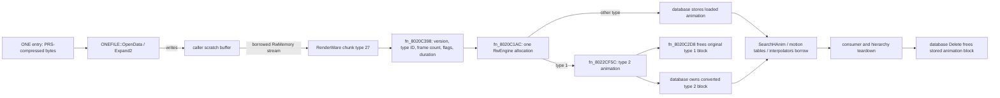

# Enemy database translation unit evidence

Symbolic metadata identifies `enemy/e_database.cpp` (CU `0x56196c`) as
C++ and supplies TEnemyDataBase, its enums, record layouts and methods.
GameCube resource-loader calls, extension dispatch, fourteen-record constructor
and singleton independently establish the correlation. No PS2 instructions
were inspected. This unit uses the completed ONEFILE interface from PR #569.

| Function | GameCube address | Bytes |
| --- | --- | ---: |
| `GetAnimationNum` | `0x801001DC` | 64 |
| `GetFileNum` | `0x8010021C` | 16 |
| `SearchCameraMotion` | `0x8010022C` | 84 |
| `SearchUVAnim` | `0x80100280` | 84 |
| `SearchHAnim` | `0x801002D4` | 84 |
| `SearchTexDictonary` | `0x80100328` | 84 |
| `SearchClump` | `0x8010037C` | 84 |
| `SetUpFiles` | `0x801003D0` | 1060 |
| `Delete` | `0x801007F4` | 376 |
| `Add` | `0x8010096C` | 136 |
| destructor | `0x801009F4` | 184 |
| constructor | `0x80100AAC` | 124 |

All twelve bodies occupy `0x801001DC–0x80100B28` (2,380 bytes).
Header singleton helpers have no surviving out-of-line bodies in this unit.
The original SearchTexDictonary spelling is retained. Owned exception records
occupy `0x8000984C–0x8000987C` (48 bytes), their index occupies
`0x8000FE50–0x8000FE80` (48 bytes), strings occupy
`0x8042B740–0x8042B778` (49 payload bytes plus seven alignment bytes), and
singleton storage occupies `0x8042C590–0x8042C598` (four bytes plus four
alignment bytes). The singleton symbol size is corrected to four bytes.
There are no other owned allocated sections, vtable or constructor list.
The Action global and RenderWare globals remain external; the metadata's
zero-address crash-vector declaration contributes no storage.

The class is 0x70 bytes: fourteen eight-byte records, each holding a resource
array pointer and signed file count. Each resource entry contains a kind enum
and pointer. Construction zeros the records and publishes the singleton.
Destruction only zeros the records: it neither releases resources nor clears
the singleton. Delete releases resources in reverse order, releases texture
dictionaries in a second reverse pass, then frees the entry array; it does
not clear the containing pointer/count. These observed lifecycle contracts
are preserved. Search indices are unsigned and retain the resource-kind gate.

SetUpFiles scans 256 archive filename slots, allocates two spare records,
loads the first available texture dictionary before other resources, then
processes clumps, animations, UV animations, splines and camera motions.
Stages 27 and 28 use a 0x190000-byte temporary buffer; other stages use
0xAF000. Type-one animations are compressed and the original is destroyed.
Add constructs a genuine ONEFILE and preserves its C++ allocation/destruction
and exception cleanup. The filename helper uses the first dot and a four-byte
comparison, matching both symbolic inline-helper metadata and GameCube code.
No additional null guards or ownership changes are introduced.

## Caller ownership and failure paths

| Entry kind | ONEFILE loader | Database cleanup | Ownership evidence |
| --- | --- | --- | --- |
| `CLUMP` | `OneFileLoadClump` | `fn_80150958` | Database owns the loaded clump; `SearchClump` returns the stored pointer. |
| `ANIMATION` | `OneFileLoadHAnimation` | `fn_8020C2D8` | Database owns the stored or compressed animation; motion tables clear `pHAA` before unload. |
| `UVANIMATION` | `OneFileLoadUVAnim` | `fn_8011B7CC` | Database owns the animation; callers use returned pointers as references. |
| `SPLINE` | `OneFileLoadSpline` | `fn_8014D8A4` | Database owns the loaded spline. |
| `CAMERAMOTION` | `OneFileLoadCameraTmb` | `fn_80132750` | Loader allocates through the ONE memory-function table; the paired release helper is external. |
| `TEX` | `OneFileLoadTextureDictionay` | `fn_801A46D0` | Database owns the dictionary; `SetUpFiles` also installs it as the current dictionary. |

The public `Search*` methods return raw pointers without retaining them. The
searcher, pawn, capture, and stage enemy unload hooks end their texture wrappers
and clear motion-table references before deleting the corresponding database
entry. `TEnemyMtnPathData` retains database pointers; `TEnemyMtnPath` passes its
model through `fn_80150588` and later destroys its own `mpClump`. That copy
relationship is corroborated by the separate teardown, but the helper's exact
RenderWare contract is not recovered here.

Failure behavior remains retail behavior. `fn_80012994` can return null when
the game heap has no fitting high-pool block, but `SetUpFiles` does not check
its temporary buffer before passing it to `OpenData`/`Expand2`; the expander
writes through its destination for non-empty data. `OneFileLoadHAnimation` can
return null, while `SetUpFiles` dereferences `anim->interpInfo` immediately.
Other typed loaders store their result after setting the entry kind, so cleanup
may pass a null resource to an external destructor whose null contract is
unknown. `ONEFILE::LoadOneFile` separately leaves its opened stream unclosed if
its archive allocation fails; see `one-unit-evidence.md`.

`Delete` frees the entry array but retains its address and count. A second
delete or a query before a subsequent successful `SetUpFiles` would use stale
state; repeated unload was not found in the inspected caller paths, so this is
a verified state hazard with practical reachability unproven. `SetUpFiles`
counts all non-empty names, then processes only IDs `[0, count + 1]`; this
assumes archive IDs are densely populated from 2. A read-only inspection of
the local retail image resolved that assumption for the enemy package set
referenced by the DOL/REL filename strings: 16 static `en_*.one` packages and
nine stage-specific `%s_flyer.one` resolutions. All 25 packages had populated,
NUL-terminated names at dense IDs 2 through the last entry; each ID had an
in-bounds data chunk with the same ID, and the outer, directory, and data chunk
lengths consumed the archive exactly. This confirms only those 25 packages,
not every ONE archive on the disc.

Across those packages, 544 entries were inspected. Each of the 16 static
enemy packages contained one TXD, while the nine stage flyer packages
contained none; the first-successful-TXD break therefore skips no additional
TXD in this set. A bounded expansion matching `Expand2`'s bitstream rules
decoded all 544 entries with a 16 MiB per-entry cap. The 531 DFF/TXD/ANM/UVB
outputs had the expected RenderWare chunk type and declared length; 13 TMB
streams terminated within their chunk bounds but were not runtime-parsed. The
largest expanded resource was 649,470 bytes, below the `0xAF000` (716,800 byte)
scratch buffer. This validates the sampled file data and capacity comparison;
it does not prove allocator success, RenderWare object construction, or runtime
behavior. None of these failure cases are changed in the matching source.

The audit also replaced divergent local declarations of `TEnemyDataBase` and
`eEnemyDataBase` in the six game consumers with the canonical header. The two
translation-unit views of the accessed `RtAnimAnimation` prefix are now shared
in `game/rtanim.h`. A CodeWarrior build and direct object diffs against the
pre-change object snapshots preserved the relevant function, data, exception,
and relocation content; the complete G9SE8P build retained all 18 reference
hashes. The `e_database.cpp` object remained byte-identical after correcting
the local allocator declaration from signed to unsigned size.

The animation-destroy return is a pointer, corroborated by its GameCube body;
UV-animation destruction returns signed int, also corroborated by symbolic SDK
metadata. Camera-motion release remains a provisional void declaration whose
return is unused. Array allocation/deallocation names are supported by
Debug.cpp metadata. All fifteen canonical symbol substitutions in ten existing
caller files preserve token-level behavior apart from formatting.

All twelve functions match directly from C++ with automatic inlining. No
object normalizer or deferred-inlining override is introduced. All function
identities, offsets, sizes and bindings match; all 67 effective relocations
and section flags/alignments match. Text and exception sections are byte-exact;
string and singleton sections agree including natural linker tail alignment.

Validation: the supported G9SE8P main DOL and all seventeen RELs compile and
all eighteen reference hashes pass. All-source compilation, progress/report
generation, 55 automated tests and both language/post-processor policies pass.
Independent code/layout and ELF audits agree. Compilation and binary comparison
do not establish runtime or physical-hardware validation.

## ANM stream and runtime ownership

This is a static reconstruction from `one.cpp`, `e_database.cpp`, the matching
G9SE8P DOL at the named symbols, and a read-only parse of the 25 enemy ONE
packages listed above. Dolphin breakpoints were not run, so the callback and
consumer behavior below is not presented as a runtime observation.

`OpenData` expands an archive entry into the caller's scratch buffer, and
`OneFileLoadHAnimation` opens a memory stream over that buffer, checks for
RenderWare chunk type 27, calls `fn_8020C398`, then closes the stream. The
returned animation is separately allocated; its lifetime does not depend on
the scratch buffer. The loader does not check the memory-stream constructor
for null. In the retail DOL, `fn_8020C398` checks the animation version marker
(`0x100`), resolves `typeID` through the interpolation-info registry, reads
the common header fields and invokes the registered stream callback. It does
not check that callback's return value before returning the animation.

The relevant stream helpers read the requested bytes and byte-swap each
32-bit word with `stwbrx`. At the `fn_8020C398` call sites this applies to the
version/type/count/flags words and the 32-bit duration field. The inspected
enemy files encode those values little-endian. This establishes the byte order
of those fields only; it does not establish one byte order for every RenderWare
or ONE field.

The retail `fn_8020C1AC` uses the registry entry's frame stride and custom-data
size to request one block of `0x18 + frameCount * frameStride + customSize`
bytes from the RwEngine allocator. It puts the `RtAnimAnimation` header first,
frames immediately after it, and optional custom data after the frames;
`interpInfo` points to the registry, not to owned animation memory. The
allocator result is dereferenced without a null check. `fn_8020C2D8` passes the
animation base to the RwEngine release callback once, so these fields are
released as one block rather than recursively.

`TEnemyDataBase::SetUpFiles` converts loaded type-1 animations with
`fn_8022CF5C`. That function requests a type-2 animation, reads source records
with a `0x24`-byte stride, emits `0x18`-byte records, quantizes four rotation
and three normalized translation components, and writes six translation
bounds values into the type-2 custom-data area. Its type-2 registration in
`fn_8022CEB0` specifies a `0x18` frame stride and `0x18` custom-data bytes;
`Initialize3D` calls that registration before normal game setup. The converter
rewrites the per-frame link into the new frame block. The database then frees
the source type-1 block and stores the type-2 block. This is a representation
conversion, separate from PRS archive decompression.

`SearchHAnim`, `nEnemyMotion::LoadAnimationDataFromONEFILE`, and
`TEnemyMtnPathData::SetUpMotionTable` store borrowed animation pointers.
`fn_8020C72C` binds an animation to an interpolator and reads its frame data;
it does not transfer ownership. The inspected searcher, pawn, and capture
unload hooks clear their motion-table pointers before `TEnemyDataBase::Delete`.
`ENEMYMTNMAN` destroys its hierarchy objects in its destructor. Static source
does not prove that every active hierarchy in every enemy module is gone
before database deletion; that lifetime ordering remains a runtime question.

The local archive/PRS pass used the .NET parser and PRS implementation from
[`HeroesONE-Reloaded`](https://github.com/Sewer56/HeroesONE-Reloaded/tree/f8cc6d784273eb9b10b55ed028007a536aba5733);
that third-party tool was not treated as an ANM semantic decoder. The pass
covered 25 enemy packages, 544 entries, and all 308 ANM entries. It found no
outer type/length mismatch, animation header mismatch, type-1 frame-length
mismatch, or expansion above its 16 MiB inspection cap. Every inspected ANM was
type 1, with 4–1740 frames, and its expanded length was exactly
`32 + frameCount * 0x24`. This corroborates the reader's input shape for these
packages; it does not test interpolation-info callbacks, object construction,
allocation success, playback, or teardown.

The same bounded pass inspected all three translation floats in the type-1
frame records. All inspected source frame values were finite, but nine
animations each have one constant translation axis (nine axes total). For
their 387 corresponding frames, the converter's `(value - center) / halfRange`
formula has a zero denominator and produces a non-finite intermediate under
IEEE single-precision arithmetic. This does not by itself establish a bad
runtime position: `fn_8022B3E4` saturates the custom 1/4/11 float code, and the
type-2 interpolation path decodes that code before multiplying by the stored
zero half-range and adding the center. The source formulas therefore reduce
those constant axes back to their center. This is a source-and-data arithmetic
analysis, not an emulator observation; it did not identify a justified source
change.

Failure paths remain unchanged in matching source. A failed `OpenData` or
malformed outer chunk can make the loader return null, which `SetUpFiles`
dereferences. A failed stream allocation is not checked before use. The
animation allocator has no OOM guard, and the reader callback's status is
ignored. These are verified unchecked paths; whether they occur with valid
retail assets is unknown. The 308-file inspection found structurally valid
ANM streams but cannot establish runtime success. No null guard or ownership
change is justified in the matching source without a separate binary-backed
reconstruction.

### Runtime-debugging limit

The official Dolphin 2609a binary is in the ignored local build scratch area;
its command line supports a user-folder option for profile isolation. Its GUI
has a debugger/breakpoint pane, but this agent environment has no
desktop-control channel to operate it. The
alternative GDB stub was not started: the official implementation binds its
server socket to all interfaces, while the active Windows Public firewall
profile is disabled. Starting that server would expose an unauthenticated
debugger on the network. No emulator run, breakpoint, memory inspection,
animation playback, or runtime destruction observation was performed. A
future runtime pass needs an interactive debugger session or an isolated
network environment before enabling GDB. Dolphin's GUI debugger and breakpoint
controls are part of its upstream application; the GDB socket behavior is
visible in its [official implementation](https://github.com/dolphin-emu/dolphin/blob/master/Source/Core/Core/PowerPC/GDBStub.cpp).
