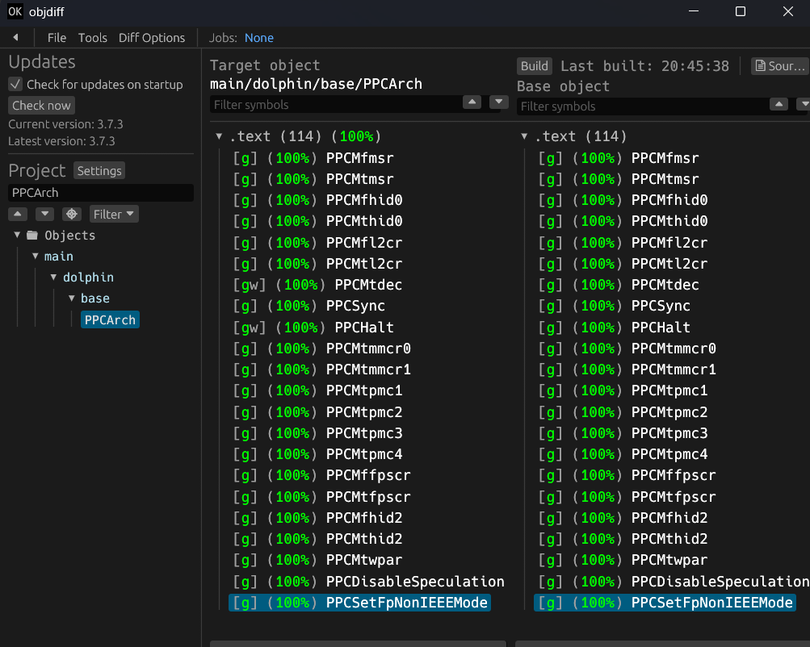

# Getting started

How to build this decompilation, check that it matches, and start matching
functions. No previous decompilation experience is needed. If anything here is
unclear or out of date, ask in `#decomp-help` on
[Discord](https://discord.gg/VGCHZMXUWN).

Read [LEGAL.md](../LEGAL.md) first. It is short, and its rules are not
negotiable.

## 1. What you need

* Python 3 and [ninja](https://github.com/ninja-build/ninja/releases) on your
  `PATH` (`pip install ninja` works too).
* Git.
* Your own, legally obtained copy of **Sonic Heroes for GameCube, North
  America, revision 0** (`G9SE8P`). Other regions are not supported yet.
* Optional but recommended: [objdiff](https://github.com/encounter/objdiff) to
  compare your code with the original, and `clang-format` so the commit hook
  can check formatting.

On Windows, use native tools (no WSL or msys2 needed). If `python3` opens the
Microsoft Store instead of Python, the commit hook cannot run: disable the
`python3.exe` app execution alias in Windows settings, or put a `python3`
wrapper for your real Python earlier on your `PATH`.

On macOS and Linux, [wibo](https://github.com/decompals/wibo) is downloaded
automatically to run the original Windows compilers.

## 2. Clone and enable the safety hook

```sh
git clone https://github.com/Jovinull/sonicheroes.git
cd sonicheroes
git config core.hooksPath .githooks
```

The hook refuses any commit that stages game data, build output or
disassembly, runs the source-language policy checks and, if `clang-format` is
installed, the format check.

## 3. Add your copy of the game

Put the game in `orig/G9SE8P/`, either as a disc image (ISO, RVZ, GCM, WBFS,
CISO, GCZ, NFS or TGC) or as files extracted with Dolphin. A disc image can be
deleted after the first build. `orig/` is ignored by git and must stay that way.

## 4. Build

```sh
python configure.py
ninja
```

The first build downloads the toolchain: the CodeWarrior compilers, a pinned
[decomp-toolkit fork](https://github.com/Jovinull/decomp-toolkit) and objdiff.
It ends by checking the SHA-1 of `main.dol` and all 17 REL modules against
`config/G9SE8P/build.sha1`. You should see `18 files OK`.

If `ninja` fails at the final link with an intermittent error on `main.elf`,
run it again before investigating.

## 5. Find something to work on

* Anything marked `NonMatching` in `configure.py` has work left in it.
* Code not yet split into a source file lives in auto-generated regions; the
  progress report lists which units and functions are still unmatched.
* Say what you are taking in `#decomp` on Discord before you start, and check
  [decomp-work-tracking.md](decomp-work-tracking.md), so two people do not
  work on the same thing.
* Do not touch the `advertiseD` and `autosaveD` overlays without asking: they
  are being worked on by other contributors.

## 6. Match it in objdiff

After the first build there is an `objdiff.json` in the project root. Open
objdiff, set **Project directory** to this repository, and pick an object in the
sidebar. Your compiled output is on one side and the original on the other; it
rebuilds automatically when you save.

Write the source in the original language (game code is C++, see
[language-policy.md](language-policy.md)) until every instruction, the data
and the relocations match. Code that only behaves the same does not count.



## 7. Before you open a pull request

```sh
ninja                                                # 18 files OK
python -m unittest discover -s tools -p "test_*.py" -t .
python tools/check_language_policy.py
python tools/check_post_processors.py
```

Then open a pull request. CI rebuilds everything and verifies every hash. If
a function is close but not matching yet, you can still open the pull request:
say what is left.

## Further reading

* [CONTRIBUTING.md](../CONTRIBUTING.md): conventions, naming and review.
* [docs/README.md](README.md): index of the other documents in this folder.
* [REFERENCES.md](../REFERENCES.md): community resources for naming functions
  and structures.
